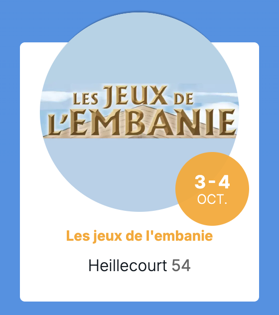

<meta property="og:image" content={frontmatter.imageUrl}/>
<meta property="og:title" content={frontmatter.title} />
<meta property="og:description" content={frontmatter.description} />
<meta property="twitter:image" content={frontmatter.imageUrl}/>
<meta property="twitter:title" content={frontmatter.title} />
<meta property="twitter:description" content={frontmatter.description} />

Ce mois de novembre, ...

**Bonne lecture ❤️**

* [Festivals et événements](#festivals-et-événements)
* [Sorties attendues](#sorties-attendues)
* [Une p'tite prez: des alternatives aux échecs ?](#une-ptite-prez-des-alternatives-aux-échecs-)
* [Quel archétype es-tu ? ⚡](#quel-archétype-es-tu--)

# Festivals et événements

| | |
| --- | --- |
|  | 2 jours de jeux, tournois tout le week-end, animations extérieures, panier garni de jeux à peser et gagner, buvette et restauration sur place.  📅 du 3 au 4 octobre 2026  - Samedi de 14h à 23h - Dimanche de 10h à 18h 🎟️ Entrée gratuite, 600 personnes estimées 📍 MTL de Heillecourt 54180 Heillecourt, Meurthe-et-Moselle|

# Sorties attendues

Quelques sorties de jeux attendus, mais bien entendu beaucoup d’autres jeux sortent ce mois ci 😁

## Extensions et suite de jeu

| | |
| --- | --- |
|  | **Faraway : Au-delà du voile**  👨‍👩‍👦 2-6 joueurs 🎂 10+ ⏱ 30 min 💡 Corentin Lebrat, Johannes Goupy 🎨 Maxime Morin 🛠️ Catch Up Games 🚚 Blackrock Games 6€ |

- Solstice edition collector

## Jeux

| | |
| --- | --- |
|  | **Fragments : Solara**  👨‍👩‍👦 1-4 joueurs 🎂 12+ ⏱ 90 min ⚙️ Coop, Narratif, Enquêtes 💡 Yohan Servais 🎨 Jiahui Eva Gao, Noëmie Chevalier 🛠️ Iello 18€ |
|  | **Le Seigneur des Anneaux - La Confrontation**  👨‍👩‍👦 2 joueurs 🎂 14+ ⏱ 30 min ⚙️ Gestion de main, Bluff, Affrontement 💡 Reiner Knizia 🎨 Collectif 🛠️ Iello ??€ |

- Skyrift aux porte de l'ombre
- Skyrift les vagues du destin
- Wingspan Pocket

# Une p'tite prez: des alternatives aux échecs ?

TODO ...

# Quel archétype es-tu ? ⚡

Ce mois ci, ...

---

J’espère que ce billet de novembre vous aura plu, si vous avez un jeu, un thème ou autre chose que vous aimeriez voir aborder la prochaine fois, n’hésitez pas à me le faire savoir 🙌

Et surtout, proposez-moi la prochaine personne qui se verra associée à des cartes Yu-Gi-Oh! pour le prochain “Quel archétype es-tu ?” 😀

Avec amitié et bisous, **Brojira**
 
